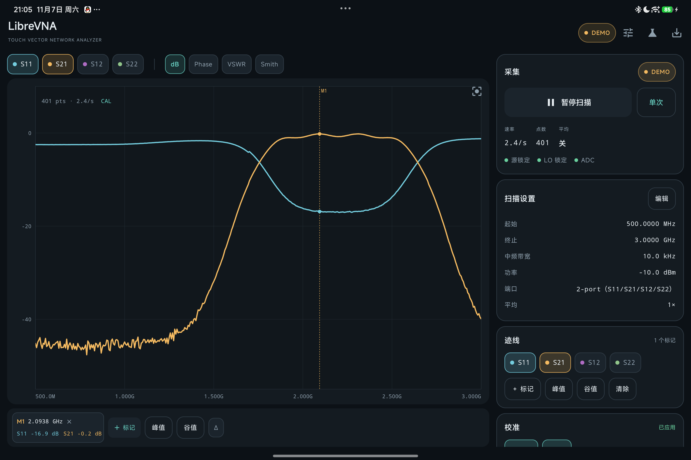
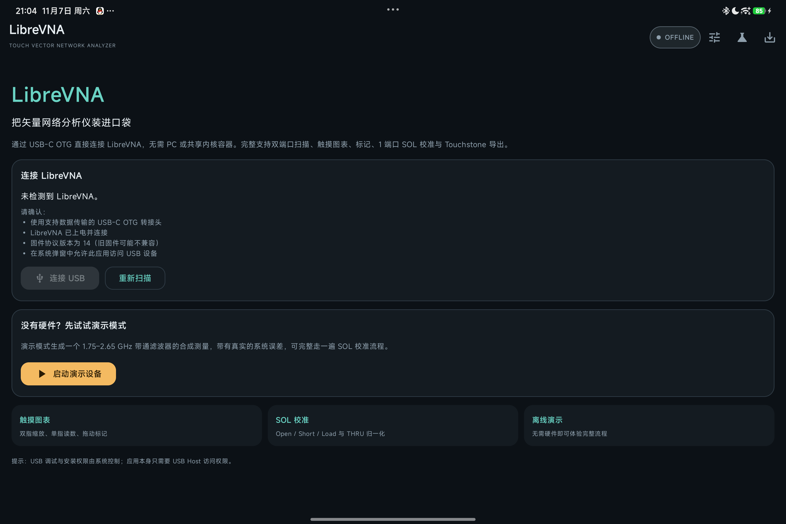
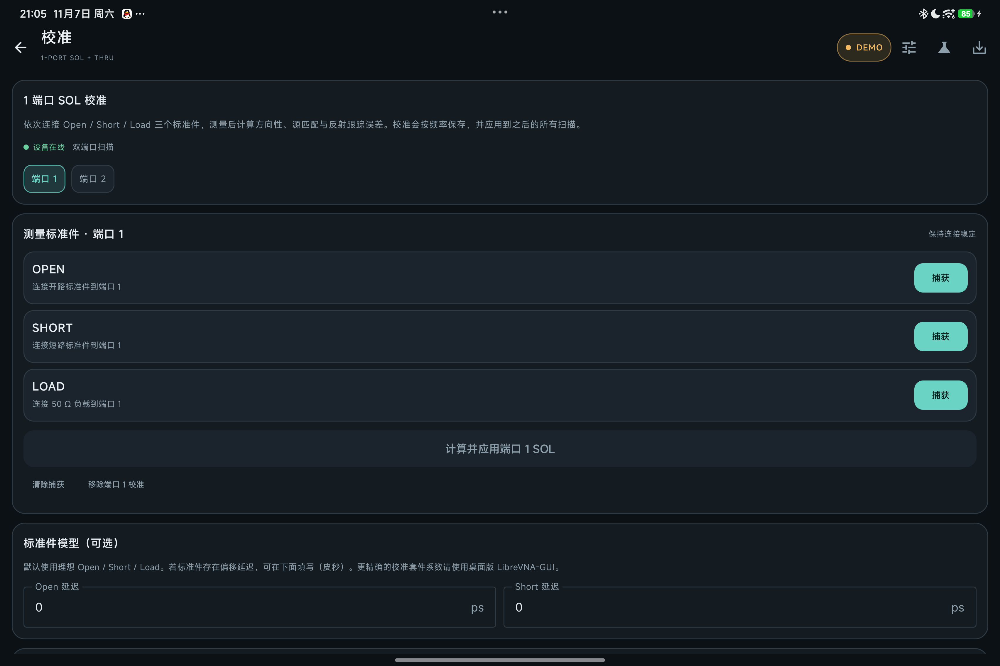
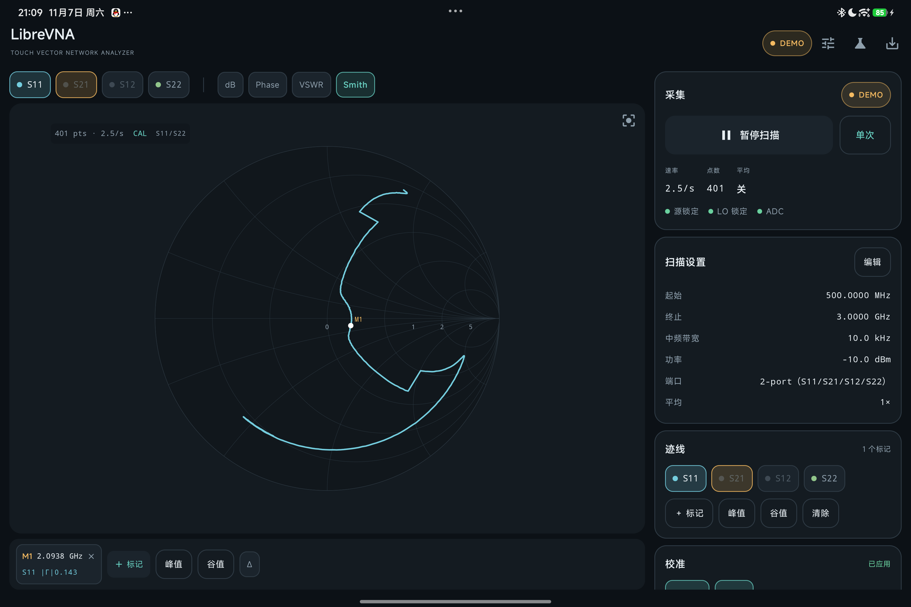
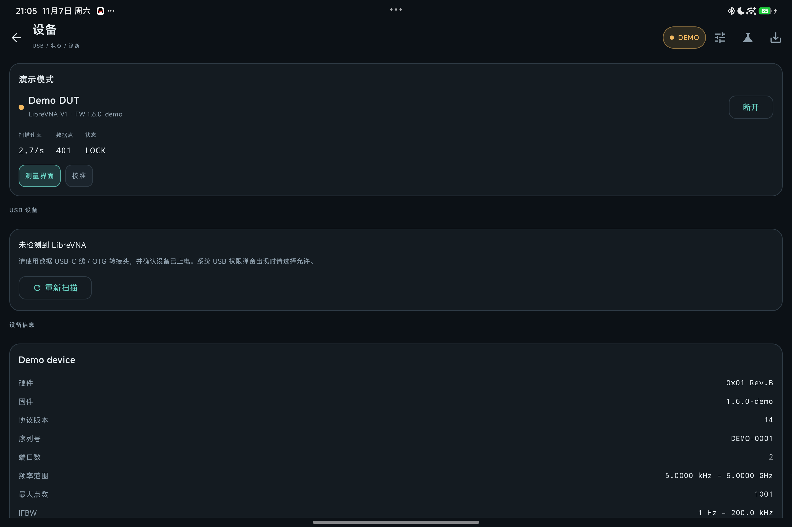

# DroidVNA

[中文](README.md) · **English**

[](https://github.com/dfdtc/DroidVNA/actions/workflows/android.yml)
[](https://github.com/dfdtc/DroidVNA/releases)
[](LICENSE)

**DroidVNA — a native Android touch client for LibreVNA / Harogic B60**. It connects a VNA directly to a tablet or phone over USB-C OTG — no PC, Termux, or shared-kernel container. The app uses the Android USB Host API to talk to the device's vendor-specific bulk endpoints and implements LibreVNA USB protocol v14 for sweep configuration, data acquisition, calibration, and export. It imports desktop `.cal` files and supports LibreCAL / Harogic ECB-60 electronic calibration. The UI ships in **Chinese / English** and can be switched at any time.

> **Disclaimer**: DroidVNA is not an official LibreVNA Android app and does not include the desktop Qt GUI. It is an Android client **rewritten from the USB protocol, calibration math and E-Cal logic of [LibreVNA-GUI](https://github.com/jankae/LibreVNA)**, released under GPL-3.0. "VNA" stands for vector network analyzer and "Droid" for Android; there is no affiliation with the LibreVNA trademark owner. See [License and notices](#license-and-notices).



## Project status

- Current version **0.7.1-beta** (versionCode 10), Android 8.0 (API 26) or newer; compileSdk / targetSdk 36.
- 0.7.1-beta adds marker analysis tools (bandwidth search / XdB search / DTF). They are validated in demo mode and unit tests; DTF distance accuracy has not been compared against a real cable or fault yet.
- The 12-term SOLT E-Cal flow has been run end-to-end on real hardware (Harogic B60 + ECB-60) and applied successfully, but **absolute accuracy has not been compared against the desktop app or a known DUT**, and the **manual SOLT flow has not been tested on hardware** yet (mechanical standards are missing). This is why the release is marked **beta**. LibreVNA's own hardware has not been tested yet.
- Detailed validation records are in [Testing](docs/en/TESTING.md); changes are in [CHANGELOG.md](CHANGELOG.md) and the [release notes](docs/en/release-notes/).

## Features

- **Real-time two-port sweeps**: S11 / S21 / S12 / S22, continuous or single sweep, pause/resume. At low IFBW the chart draws points as they arrive and updates with a ring buffer, never clearing every frame.
- **Touch-first chart**: pinch to zoom/pan, single-finger cursor readout, dB / phase / VSWR / Smith modes; draggable markers, peak/valley search, dual-marker Δ.
- **Marker analysis**: the "Analysis" menu next to the marker shortcuts provides bandwidth search, XdB search (left/right/both sides) and DTF (windowed IFFT with a distance-domain trace and fault table).
- **Complete calibration chain**: 1-port SOL, THRU normalization, full 12-term two-port SOLT (optional isolation measurement), LibreCAL / ECB-60 electronic calibration, and LibreVNA-GUI `.cal` import. Results are stored per device serial and loaded automatically on the next launch.
- **Data export**: Touchstone `.s2p` / `.s1p` and CSV to `Download/DroidVNA`, or share through the system share sheet.
- **Touch UI**: a single `⋮` overflow menu, collapsible control rows, a vertical acquisition rail in landscape, a background watermark; sweep settings, markers, chart mode, and UI language are remembered.
- **Bilingual UI**: follow system / Chinese / English, applied immediately and persisted.
- **Plug and play**: recognizes LibreVNA V1 / P2 / PT and Harogic B60 (LibreVNA USB protocol v14), with USB diagnostics and a device log; the B60 always receives the full 32-byte `SweepSettings` (including the `extTrigger` extension byte), and a silent configuration is re-sent automatically.
- **Demo mode**: a 1.75–2.65 GHz band-pass filter DUT with a realistic error model, so the full calibration and export flow works without hardware.

See the [User guide](docs/en/USER-GUIDE.md) for complete features and operation.

## Screenshots

| Connect | Calibration |
| --- | --- |
|  |  |

| Smith chart | Device |
| --- | --- |
|  |  |

More screenshots (E-Cal, B60, landscape, English UI) are in [docs/screenshots](docs/screenshots/).

## Download and install

- Download the latest APK from [Releases](https://github.com/dfdtc/DroidVNA/releases), or use [dist/DroidVNA-0.7.1-beta-release.apk](dist/DroidVNA-0.7.1-beta-release.apk) from the repository.
- Requirements: Android 8.0 (API 26) or newer, a device and cable with USB Host / OTG support, and VNA firmware protocol version 14.

```bash
adb install -r dist/DroidVNA-0.7.1-beta-release.apk
```

The APK is a release build signed with the project release key (certificate CN=Houran CHEN). Re-signing with a different keystore prevents in-place upgrades; uninstall first. See [Releasing](docs/en/RELEASING.md) for the signing flow.

For installation, connecting the device, and first use, see the [User guide](docs/en/USER-GUIDE.md). Xiaomi/HyperOS installation failures are covered in [Troubleshooting](docs/en/TROUBLESHOOTING.md).

## Documentation

| Document | Contents |
| --- | --- |
| [Documentation index](docs/en/README.md) | Entry point for all English docs |
| [User guide](docs/en/USER-GUIDE.md) | Installation, connecting a USB VNA, touch gestures, settings, export |
| [Calibration guide](docs/en/CALIBRATION.md) | 1-port SOL, full SOLT, E-Cal, `.cal` import, isolation re-measurement |
| [Troubleshooting](docs/en/TROUBLESHOOTING.md) | Common symptoms and fixes |
| [Building and development](docs/en/DEVELOPMENT.md) | Build, signing, project layout, protocol notes |
| [Testing](docs/en/TESTING.md) | Unit tests, hardware validation, SOLT acceptance procedure |
| [Roadmap and limitations](docs/en/ROADMAP.md) | Current boundaries and next steps |
| [Releasing](docs/en/RELEASING.md) | Release steps |
| [Changelog](CHANGELOG.md) / [release notes](docs/en/release-notes/) | Version history |
| [中文 README](README.md) / [中文文档](docs/README.md) | Chinese documentation |

## Known limitations

- No firmware update, manual control, signal generator, spectrum analysis, amplitude/power calibration, frequency calibration, or SCPI server.
- Full 12-term SOLT is two-port only; three/four-port devices are not implemented.
- The chart is a custom Compose Canvas and is not optimized for very large point counts (>1001).
- English translations cover the main UI and common messages; a few low-level device/protocol log lines may remain in Chinese.

See [Roadmap and limitations](docs/en/ROADMAP.md) for the complete list.

## Contributing

Issues and pull requests are welcome. Read [CONTRIBUTING](CONTRIBUTING.en.md) first; it covers the build, tests, hardware validation, and code style.

- Bug reports should include the app version, Android version, VNA/E-Cal model and firmware, reproduction steps, and the device log.
- Run `./gradlew testDebugUnitTest` and `./gradlew assembleDebug` before submitting.
- Do not commit `local.properties`, keystores, `build/`, `LibreVNA/`, or handout files.

## License and notices

### What this project wrote and what it borrowed

DroidVNA's **UI, chart, touch interaction, USB permission flow, export, and demo mode** are new Kotlin/Compose code written for Android; **no LibreVNA C++/Qt code is compiled or linked**. The parts below, however, are **not independently designed** — they were rewritten/translated from LibreVNA-GUI sources:

| Module | Upstream |
| --- | --- |
| `usb/Protocol.kt` frame, CRC, SweepSettings, DeviceInfo, Datapoint | LibreVNA firmware/USB protocol v14, LibreVNA-GUI driver |
| `model/Calibration.kt` SOL error model and solver | LibreVNA-GUI calibration math |
| `model/Solt.kt` 12-term error model, closed-form `computeOSL`/`computeSOLT`, multiport correction | `Calibration/calibration.cpp` (`Point`, `computeOSL`, `computeSOLT`, `correctMeasurement`) |
| `model/CalStandardModel.kt` Open/Short/Load/Through parameter model | `Calibration/calstandard.cpp`, `Util::addTransmissionLine` |
| `model/CalibrationFileImporter.kt` `.cal` format 3 | LibreVNA-GUI calibration file format |
| `usb/EcalDevice.kt`, `model/EcalCoefficients.kt` E-Cal SCPI and flow | `Calibration/LibreCAL/caldevice.cpp`, `librecaldialog.cpp` |

Therefore **this project is treated as a GPL-3.0 derivative work of LibreVNA-GUI**, not as an independent implementation that could be relicensed under MIT/Apache.

### License and acknowledgements

- Released under the **GNU General Public License v3.0**. The full text is in [LICENSE](LICENSE); copyright and third-party notices are in [NOTICE](NOTICE).
- Copyright (C) 2026 The DroidVNA Authors.
- LibreVNA hardware, firmware, USB protocol, and the desktop GUI were created by Jan Käberich and contributors: <https://github.com/jankae/LibreVNA>, also released under GPL-3.0.
- AndroidX, Jetpack Compose, Kotlin, and Kotlin Coroutines are used under the Apache License 2.0.

### Naming and trademarks

- The app is called **DroidVNA**: "Droid" refers to Android, "VNA" to a vector network analyzer (a generic term).
- The former name "LibreVNA Mobile" contained the third-party product name **LibreVNA** and could be mistaken for an official product; it was renamed.
- This project has **no affiliation, sponsorship, or endorsement** relationship with the LibreVNA project, Jan Käberich, or Harogic. LibreVNA is mentioned in the README, the in-app About panel, and driver logs only to describe compatibility and provenance.

### AI Generated Content Declaration

- This project almost entirely generated by AI/SI (for viewer from the US), except this declaration and open source License.
- 此项目的几乎全部内容都完全由AI生成，除了这个声明以外。
