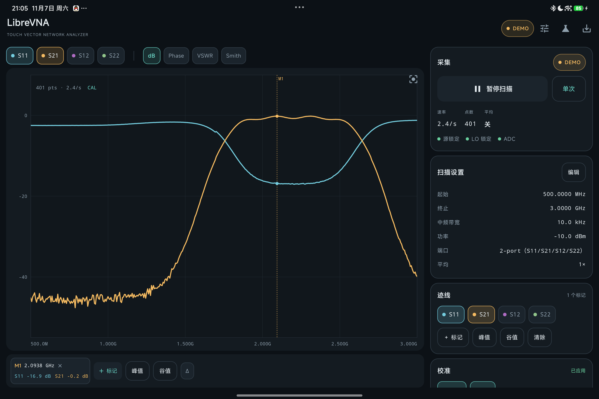
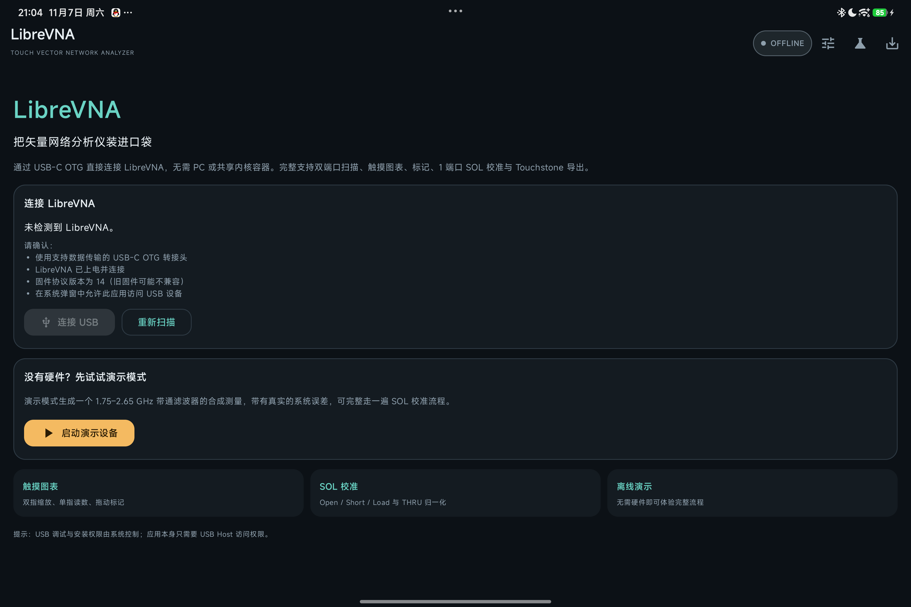
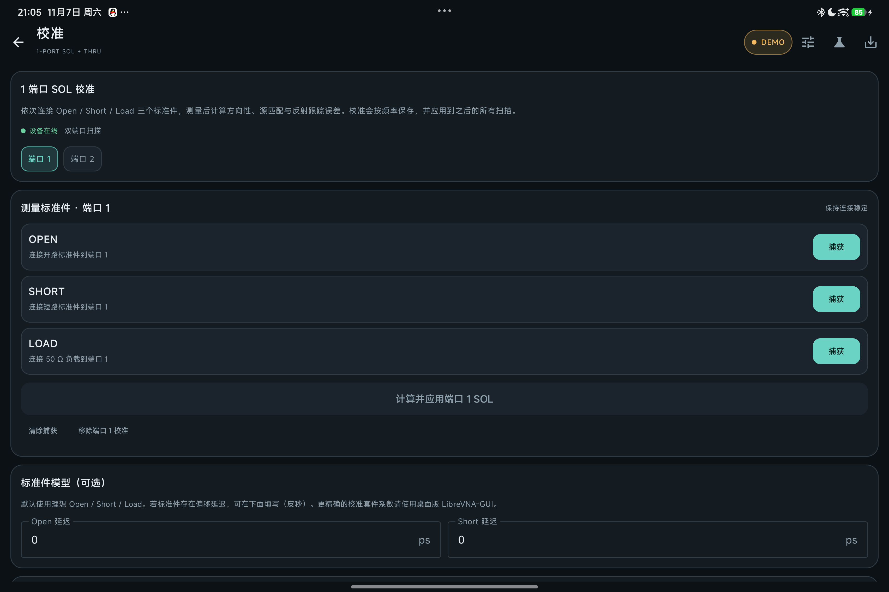
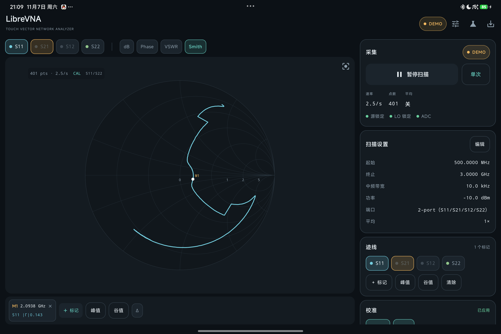
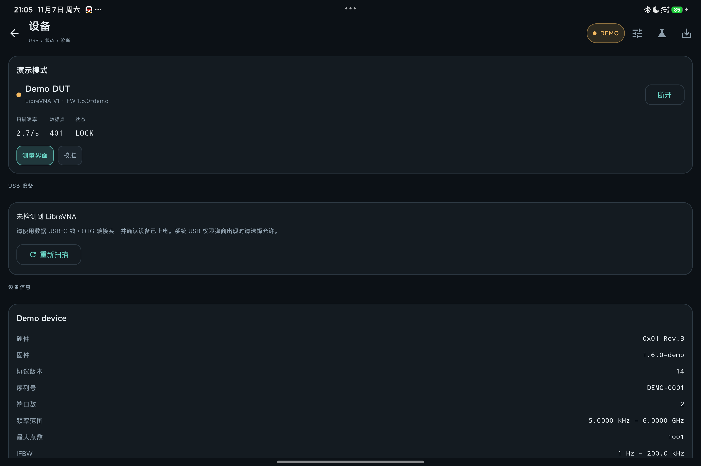

# DroidVNA

**中文** · [English](README.en.md)

[](https://github.com/dfdtc/DroidVNA/actions/workflows/android.yml)
[](https://github.com/dfdtc/DroidVNA/releases)
[](LICENSE)

**DroidVNA — LibreVNA / Harogic B60 的原生 Android 触屏客户端**。通过 USB-C OTG 直接把 VNA 接到平板或手机，不需要 PC、Termux 或共享内核容器。应用使用 Android USB Host API 直接访问设备的 vendor-specific bulk 端点，按 LibreVNA USB 协议 v14 完成扫描设置、数据接收、校准与导出；支持导入电脑版 `.cal`，以及 LibreCAL / Harogic ECB-60 电子校准件的自动校准。界面内置 **中文 / English** 两套文案，可随时切换。

DroidVNA is a touch-first, native Android USB host client for LibreVNA and Harogic B60 vector network analyzers. It speaks the LibreVNA USB protocol v14 directly (no PC, no Termux), supports full 12-term two-port SOLT calibration plus 1-port SOL and THRU, LibreVNA-GUI `.cal` import, and LibreCAL / ECB-60 electronic calibration. Licensed under GPL-3.0.

> **声明**：DroidVNA 不是 LibreVNA 官方 Android 版，也不包含桌面 Qt GUI。它是**基于 [LibreVNA-GUI](https://github.com/jankae/LibreVNA) 的 USB 协议、校准数学与 E-Cal 逻辑改写**的 Android 客户端，按 GPL-3.0 发布；应用名中的 “VNA” 指矢量网络分析仪，“Droid” 指 Android，与 LibreVNA 商标所有者无隶属关系。详见 [许可与声明](#许可与声明)。



## 项目状态

- 当前版本 **0.7.0-beta**（versionCode 9），要求 Android 8.0（API 26）及以上；compileSdk / targetSdk 36。
- 12 项 SOLT 的 E-Cal 自动流程已在真机（Harogic B60 + ECB-60）上跑通并成功应用，但**绝对精度尚未与桌面版 / 已知 DUT 对照**，**手动 SOLT 流程尚未上机**（缺机械校准件），因此本版标记为 **beta**；LibreVNA 官方硬件尚未上机实测。
- 详细验证记录见 [测试与验证](docs/TESTING.md)，变更见 [CHANGELOG.md](CHANGELOG.md) 与 [Release Notes](docs/release-notes/)。

## 功能

- **实时双端口扫描**：S11 / S21 / S12 / S22，连续扫描或单次扫描，可暂停/恢复；低 IFBW 下边扫边画、环形滚动更新，图表不会每帧清空。
- **触摸优先的图表**：双指缩放/平移、单指十字光标读数、dB / 相位 / VSWR / Smith 四种模式；标记可拖动、峰值/谷值搜索、双标记 Δ。
- **完整校准链路**：1 端口 SOL、THRU 归一化、完整 12 项双端口 SOLT（可选隔离测量）、LibreCAL / ECB-60 电子校准件、LibreVNA-GUI `.cal` 导入；结果按设备序列号保存并在下次启动时自动载入。
- **数据导出**：Touchstone `.s2p` / `.s1p` 与 CSV，保存到 `Download/DroidVNA`，也可通过系统分享发送。
- **触屏界面**：右上角 `⋮` 统一菜单、可收起控件行、横屏竖排采集栏、背景水印；扫描参数、标记、图表模式和界面语言自动记忆。
- **中英双语**：跟随系统 / 中文 / English 即时切换并持久化。
- **即插即用**：识别 LibreVNA V1 / P2 / PT 与 Harogic B60（LibreVNA USB 协议 v14），提供 USB 诊断与设备日志；B60 FW 1.8.6 的首次配置问题可自动恢复。
- **演示模式**：内置 1.75–2.65 GHz 带通滤波器 DUT 和真实误差模型，没有硬件也能完整走通校准与导出。

完整功能与操作说明见 [使用指南](docs/USER-GUIDE.md)。

## 截图

| 连接页 | 校准 |
| --- | --- |
|  |  |

| Smith 圆图 | 设备页 |
| --- | --- |
|  |  |

更多截图（E-Cal、B60、横屏、英文界面等）见 [docs/screenshots](docs/screenshots/)。

## 下载与安装

- 从 [Releases](https://github.com/dfdtc/DroidVNA/releases) 下载最新 APK，或使用仓库内的 [dist/DroidVNA-0.7.0-beta-release.apk](dist/DroidVNA-0.7.0-beta-release.apk)。
- 要求：Android 8.0（API 26）及以上、支持 USB Host / OTG 的设备与数据线，VNA 固件协议版本 14。

```bash
adb install -r dist/DroidVNA-0.7.0-beta-release.apk
```

该 APK 是 release 构建，使用项目发布密钥签署（证书 CN=Houran CHEN）；换用别的 keystore 重新签名后无法覆盖安装，只能先卸载。签名流程见 [发布流程](docs/RELEASING.md)。

安装、连接设备与首次使用请见 [使用指南](docs/USER-GUIDE.md)；小米/HyperOS 安装失败见 [故障排查](docs/TROUBLESHOOTING.md)。

## 文档

| 文档 | 内容 |
| --- | --- |
| [文档索引](docs/README.md) | 全部文档入口 |
| [使用指南](docs/USER-GUIDE.md) | 安装、连接 USB VNA、触屏操作、设置、导出 |
| [校准指南](docs/CALIBRATION.md) | 1 端口 SOL、完整 SOLT、E-Cal、`.cal` 导入、隔离补测 |
| [故障排查](docs/TROUBLESHOOTING.md) | 常见现象与处理 |
| [构建与开发](docs/DEVELOPMENT.md) | 构建、签名、目录结构、协议实现要点 |
| [测试与验证](docs/TESTING.md) | 单元测试、真机验证记录、SOLT 验收建议 |
| [路线图与已知限制](docs/ROADMAP.md) | 当前边界与后续方向 |
| [发布流程](docs/RELEASING.md) | 版本发布步骤 |
| [更新日志](CHANGELOG.md) / [Release Notes](docs/release-notes/) | 版本变更 |
| [贡献指南](CONTRIBUTING.md) | 开发环境与提交要求 |
| [English documentation](README.en.md) | 英文 README 与 [docs/en](docs/en/README.md) |

## 已知限制

- 没有固件更新、手动控制、信号源、频谱分析、幅度/功率校准、频率校准和 SCPI 服务器。
- 完整 12 项 SOLT 仅支持双端口；三/四端口设备的扩展未实现。
- 图表为自绘 Compose Canvas，极大点数（>1001）未做性能优化。
- 英文翻译覆盖主要界面和常见消息；极少数底层设备/协议日志可能保留原文。

完整列表见 [路线图与已知限制](docs/ROADMAP.md)。

## 贡献

欢迎提交 issue 和 PR。开始前请阅读 [CONTRIBUTING.md](CONTRIBUTING.md)，其中包含构建、测试、硬件验证和代码风格要求。

- Bug 报告请附应用版本、Android 版本、VNA/E-Cal 型号与固件、复现步骤和设备日志。
- 提交前请运行 `./gradlew testDebugUnitTest` 和 `./gradlew assembleDebug`。
- 请勿提交 `local.properties`、keystore、`build/`、`LibreVNA/` 或 handout 文件。

## 许可与声明

### 本项目做了什么，借用了什么

DroidVNA 的 **UI、图表、触摸交互、USB 权限流程、导出和演示模式** 是为 Android 新写的 Kotlin/Compose 代码，**没有编译或链接 LibreVNA 的 C++/Qt 代码**。但下面这些部分**不是独立设计的**，而是依据 LibreVNA-GUI 的源码改写/翻译：

| 模块 | 对应上游 |
| --- | --- |
| `usb/Protocol.kt` 帧、CRC、SweepSettings、DeviceInfo、Datapoint | LibreVNA 固件/USB 协议 v14、LibreVNA-GUI 驱动 |
| `model/Calibration.kt` SOL 误差模型与求解 | LibreVNA-GUI 校准数学 |
| `model/Solt.kt` 12 项误差模型、`computeOSL`/`computeSOLT` 闭式解、多端口修正 | `Calibration/calibration.cpp`（`Point`、`computeOSL`、`computeSOLT`、`correctMeasurement`） |
| `model/CalStandardModel.kt` Open/Short/Load/Through 参数模型 | `Calibration/calstandard.cpp`、`Util::addTransmissionLine` |
| `model/CalibrationFileImporter.kt` `.cal` format 3 | LibreVNA-GUI 校准文件格式 |
| `usb/EcalDevice.kt`、`model/EcalCoefficients.kt` E-Cal SCPI 与流程 | `Calibration/LibreCAL/caldevice.cpp`、`librecaldialog.cpp` |

因此 **本项目按 GPL-3.0 对 LibreVNA-GUI 的衍生作品对待**，而不是可以改为 MIT/Apache 的独立实现。

### 许可与致谢

- 本项目以 **GNU General Public License v3.0** 发布，完整文本见 [LICENSE](LICENSE)，版权与第三方声明见 [NOTICE](NOTICE)。
- Copyright (C) 2026 The DroidVNA Authors。
- LibreVNA 硬件、固件、USB 协议与桌面 GUI 由 Jan Käberich 及贡献者开发，项目地址：<https://github.com/jankae/LibreVNA>，同样以 GPL-3.0 发布。
- AndroidX、Jetpack Compose、Kotlin 和 Kotlin Coroutines 使用 Apache License 2.0。

### 名称与商标

- 应用名为 **DroidVNA**：“Droid” 指 Android，“VNA” 指矢量网络分析仪（通用术语）。
- 原名 “LibreVNA Mobile” 含有第三方产品名 **LibreVNA**，容易被认为是官方产品，已改名。
- 本项目与 LibreVNA 项目、Jan Käberich 以及 Harogic 均**无隶属、赞助或背书关系**；README、应用内“关于”和驱动日志中提及 LibreVNA，仅用于说明兼容性与出处。

### AI Generated Content Declaration

- 此项目的几乎全部内容都完全由AI生成，除了这个声明以外。
- This project almost entirely generated by AI/SI (for viewer from the US), except this declaration and open source License.
