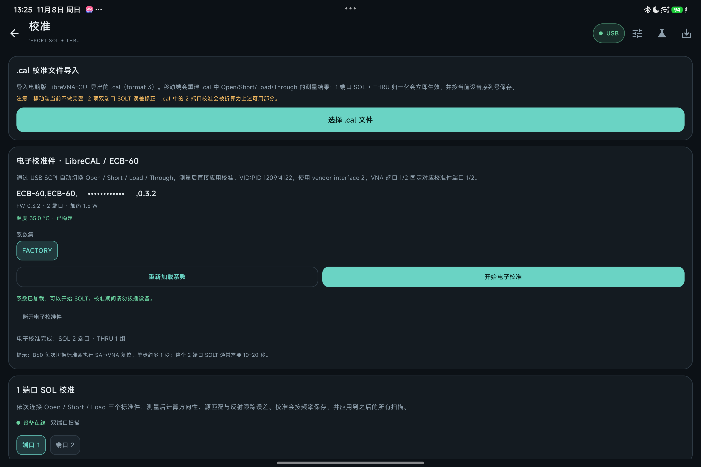

# 校准指南

> English version: [docs/en/CALIBRATION.md](en/CALIBRATION.md)

DroidVNA 支持 1 端口 SOL、THRU 归一化、完整 12 项双端口 SOLT、LibreCAL / ECB-60 电子校准件，以及电脑版 LibreVNA-GUI 的 `.cal` 文件导入。

校准结果会立即保存为快照，并**按设备序列号隔离**：演示模式或另一台 VNA 的校准不会被应用到当前设备上。重启后自动载入并应用。

## 校准方式一览

| 方式 | 需要的标准件 | 修正内容 |
| --- | --- | --- |
| 1 端口 SOL | Open / Short / Load | 方向性、源匹配、反射跟踪 |
| THRU 归一化 | 直通 | S21 / S12 的 0 dB 归一化（不含失配修正） |
| 完整 12 项 SOLT | 两端 Open / Short / Load + THRU，可选隔离 | 方向性、源匹配、反射跟踪、接收机匹配、传输跟踪、隔离 |
| 电子校准件（LibreCAL / ECB-60） | 校准件本身 | 由校准件系数自动解出，单端口件得到 1 端口 SOL，双端口件得到完整 SOLT |
| `.cal` 导入 | 电脑版完成的校准文件 | 按文件内容重建（数据足够时为完整 SOLT） |

## 从电脑导入 .cal

1. 在电脑版 LibreVNA-GUI 完成校准（SOL / SOLT / THRU），保存为 `.cal`（format 3）。
2. 把 `.cal` 拷到平板（USB、网盘、LocalSend 均可）。
3. 平板先连接 VNA，打开「校准 → .cal 校准文件导入 → 选择 .cal 文件」。
4. 应用解析 calkit 和测量点，重建校准（数据足够时是完整 12 项 SOLT），并按当前 VNA 序列号保存。

限制：若 `.cal` 只包含单端口测量，移动端只能重建 1 端口 SOL + THRU；两端口的 1 端口测量 + THRU 都在时才会重建完整 12 项 SOLT。如果 `.cal` 记录的是另一台 VNA，界面会提示，精度可能下降。calkit 支持 Touchstone 数据，也支持纯参数化 Open/Short/Load（C/L/Cfirst 等）以及参数化 Through（Z0/delay/loss）。

## 电子校准件 LibreCAL / ECB-60

1. 用带外部供电的 OTG Hub 同时连接 VNA 与校准件（ECB-60 有加热器，手机直供可能不够）。
2. 「校准 → 电子校准件」→「检测并连接」，允许 USB 权限，确认 IDN / FW / 端口 / 温度。
3. 选择系数集（通常 `FACTORY`）→「加载系数」，等待进度到 100%。
4. 固定手动映射 VNA P1 ↔ Cal P1、P2 ↔ Cal P2，**不使用 Auto**；点「开始电子校准」。
5. 应用会先把**所有用到的 E-Cal 端口设成同一个标准**（Open/Short/Load），再测所有 VNA 端口；THRU 前先全部设回 NONE，再建立 P1→P2 直通；结束把所有 cal 端口设回 NONE。
6. 双端口校准件会一次性解出**完整 12 项 SOLT**并立即应用；单端口校准件只能得到 1 端口 SOL。

**隔离测量是可选勾选框，默认关闭。** 打开后校准最后会再花约几秒，把所有 cal 端口切到 LOAD 测一次隔离。默认关闭的原因：ECB-60 这类双端口电子校准件的隔离通路本身很差，它测出的串扰往往比用两个机械 50 Ω 负载测的还差；这种情况下更好的做法是先用 E-Cal 完成其余 11 项，之后再用机械负载**单独补测隔离**（见下一节）。

注意：温度未稳定时会等待最多 90 秒；B60 每次切换标准会执行 SA→VNA 复位，整体耗时比桌面版长。端口状态每次都会用 `:PORT?` 校验，系数流必须完整；否则会中止或回退逐点读取，避免截断系数造成“杂散”校准。

**电子校准件实机（ECB-60，FW 0.3.2；FACTORY 系数加载与校准流程）：**

## 手动 1 端口 SOL

1. 连接设备或启动演示模式。
2. 打开「校准」页，选择端口 1 或端口 2。
3. 按提示依次连接 **Open / Short / Load**（端口 2 会自动切换为双端口扫描）。
4. 每次点击「捕获」，应用会等待下一次完整扫描并保存原始数据。
5. 点「计算并应用端口 N SOL」。
6. 如需修正 S21/S12 响应，把 Port 1 与 Port 2 直连，捕获 THRU 后点「应用 THRU 归一化」。

## 手动完整 SOLT（双端口）

1. 连接设备（双端口）或启动演示模式，先确定扫描频率与点数。
2. 依次捕获 **端口 1** 的 Open / Short / Load，再捕获 **端口 2** 的 Open / Short / Load（在校准页切换「端口 1 / 端口 2」）。
3. 用低损耗直通连接 P1 ↔ P2，捕获 **THRU**。若直通件有额外电长度，在「THRU 延迟」里填皮秒值。
4. 可选：两端各接 50 Ω 负载，捕获 **ISOLATION**，把残余串扰从 S21 / S12 中扣除；跳过则按零隔离处理。
5. 点「计算并应用完整 SOLT」。

## 单独补测 / 替换隔离项

隔离项可以**在不重做其他测量的前提下单独替换**，无论当前校准来自手动 SOLT、`.cal` 导入还是 E-Cal：

1. 保持当前扫描设置不变，两端各接一个 50 Ω 负载。
2. 在「双端口 SOLT」分区点 **捕获**（ISOLATION 卡片）。
3. 点 **「只用本次捕获更新隔离项」**。

原理：传输跟踪是按 `(THRU 实测 S21 − 隔离)` 求出的，所以改了隔离必须重算 T。应用会把 THRU 的实测值与理想值一起保存在校准快照里（`calibration.json` 的 `solt.through`），因此重算的是**精确值**，而不是近似修一下 —— 反射项和 load match 完全不动。也可以用「清除隔离修正」把隔离归零。

LibreVNA 的 `.cal` 格式本身就是**按测量项存储**的（`measurements` 里每项一条，隔离是独立的 `Isolation` 项），所以这种“只换一项测量”的做法与桌面版的数据模型一致；限制只在我们自己的 `calibration.json` 上，而它现在也保存了 THRU 原始数据，因此可以做到精确重算。

## 校准记忆与已校准频段

- 校准按频率保存到应用私有目录（`filesDir/calibration.json`，格式 version 3；旧版本文件仍可载入），重启后自动载入并自动应用。
- 快照记录设备序列号、来源（手动 SOLT / SOL / THRU / E-Cal / `.cal` 导入）和更新时间，在「应用设置 → 校准记忆」里可见，也可一键停用或删除。
- 测量页顶部会提示「已自动载入上次校准」；「停用校准」保留系数但只看原始数据，「忘记已保存的校准」则删除快照。
- **扫描范围超出已校准频段时会提示**：测量页的「校准」卡片和校准页的状态卡都会显示「测量范围覆盖未校准频段」，并给出已校准频段；超出部分按未校准处理（与修正引擎跳过带外点的行为一致）。

## 实现说明

- 1 端口误差模型：`Γm = e00 + e01e10·Γa / (1 - e11·Γa)`。用 Open/Short/Load 三组测量解出 e00、e11、e01e10（与 LibreVNA-GUI `computeOSL` 相同的闭式解），再按频率插值应用到 S11 或 S22。
- 12 项模型：在 1 端口三项之上，用 THRU 测量解出接收机匹配（load match）、传输跟踪与隔离，共 12 项；修正按多端口公式 `S = B·A⁻¹` 逐点进行（复数 2×2 求解使用 Apache Commons Math 的 `FieldLUDecomposition`）。
- 完整 SOLT 存在时优先于 1 端口 SOL / THRU 归一化应用；两者同时存在不会重复修正。
- 标准件默认按理想 Open（Γ=+1）、Short（Γ=-1）、Load（Γ=0）、THRU（理想直通）处理，可填写 Open/Short 的偏移延迟和 THRU 延迟（ps）。
- **手工 SOLT 会校验各次捕获的扫描范围**：Open/Short/Load/THRU/隔离的起止频率必须一致，否则直接拒绝并提示（重采样到更窄网格会把带外点静默钳位到端点值，解出的误差项会错得没有症状）。`.cal` 导入同样要求 THRU 与端口 2 的频段覆盖端口 1，否则不生成完整 SOLT 并给出警告。
- **标准件过于接近时拒绝求解**：方程为奇异（行列式趋零）或解出的方向性/源匹配幅值超过 10（物理上不可能的量级）都会判为无解，而不是应用一组离谱的系数。注意这只能挡住"数值上爆掉"的情况；把 Open 和 Short 插反这类错误从数据本身无法识别。
- THRU 归一化保存的是 `实测/理想`（与 `.cal` 导入的语义一致）；THRU 延迟为 0 时理想直通为 1，等同于传统的 0 dB 归一化。
- **仍然不做**源/接收机幅度校准（功率校准）、频率校准和校准套件高阶系数拟合；标准件按理想或导入的 Touchstone / 参数模型处理。需要计量级结果请使用桌面版 LibreVNA-GUI。

## 已知限制

- 完整 12 项 SOLT 支持双端口（2 端口即全部 12 项）；三端口/四端口设备的扩展未实现。手动 THRU 按理想直通处理，非理想直通请填延迟或改用 E-Cal / `.cal`。
- 双端口电子校准件（如 ECB-60）的隔离通路较差，E-Cal 自带的隔离测量默认关闭；需要隔离修正时建议用两个机械 50 Ω 负载单独补测（校准页支持只替换隔离项）。
- 没有独立的 Touchstone 校准套件文件导入；`.cal` 导入可重建完整 SOLT，但单端口 `.cal` 仍只得到 1 端口 SOL + THRU。
- E-Cal 固定 VNA P1/P2 ↔ Cal P1/P2 映射，不包含自动端口识别；需要带外部供电的 OTG Hub。
- 校准后曲线没变化、`.cal` 导入失败等问题的处理见 [故障排查](TROUBLESHOOTING.md)。

更多限制见 [路线图与已知限制](ROADMAP.md)。
