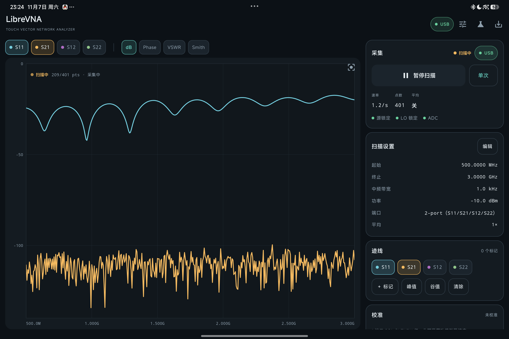
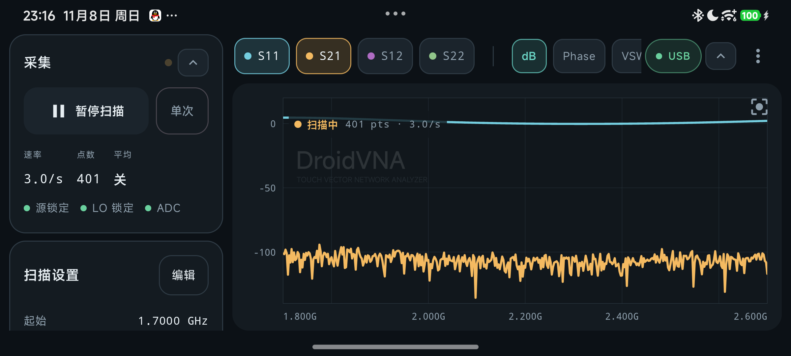
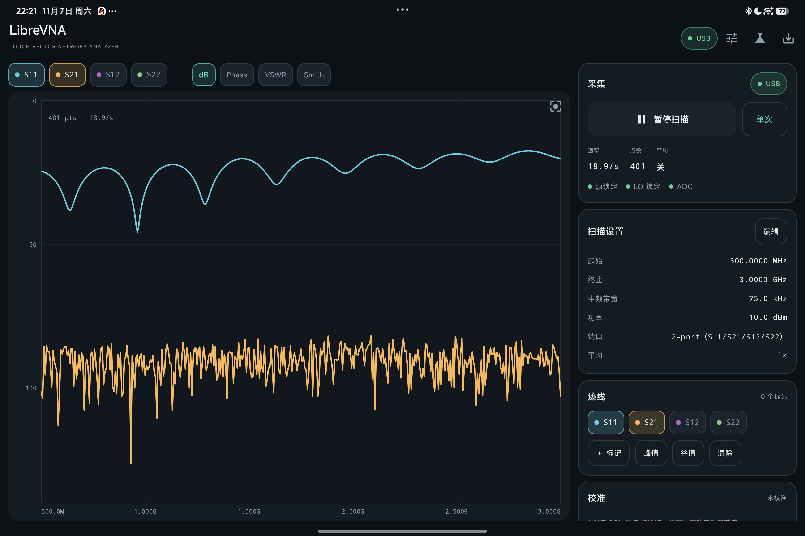
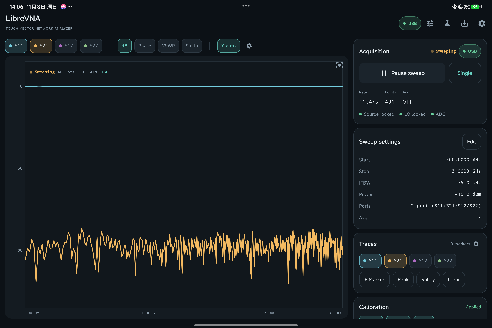
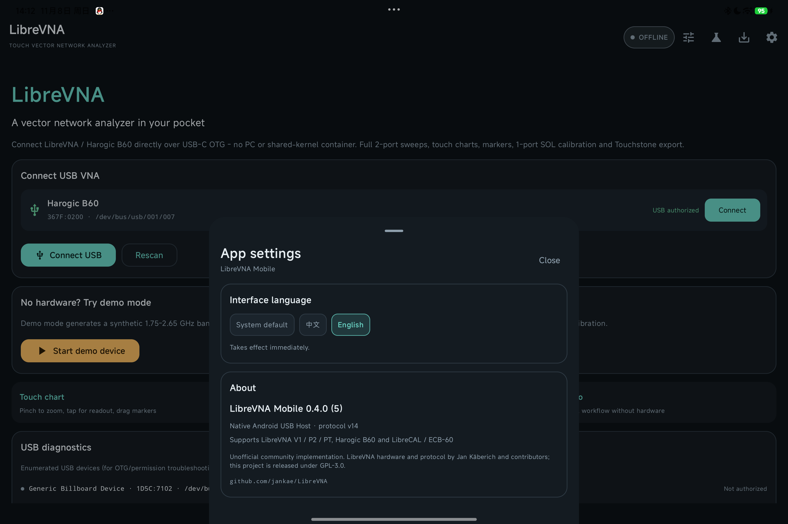
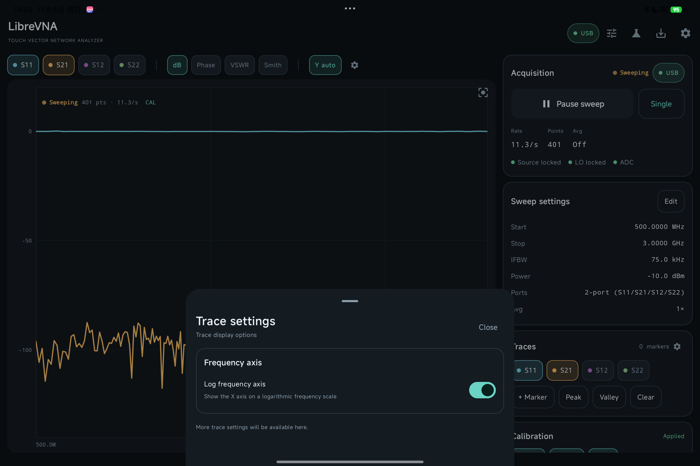

# 使用指南

> English version: [docs/en/USER-GUIDE.md](en/USER-GUIDE.md)

本指南覆盖 DroidVNA 的安装、连接设备、触屏操作、界面设置与数据导出。

- 校准（SOL / SOLT / E-Cal / `.cal` 导入）：见 [校准指南](CALIBRATION.md)
- 遇到问题：见 [故障排查](TROUBLESHOOTING.md)
- 构建与开发：见 [构建与开发](DEVELOPMENT.md)
- 版本变更：见 [更新日志](../CHANGELOG.md) 与 [Release Notes](release-notes/)

## 功能一览

### 测量与图表

- **实时双端口扫描**：S11 / S21 / S12 / S22，连续扫描或单次扫描，可暂停/恢复。
- **慢速扫描进度可见**：低 IFBW 下首帧较慢时，侧栏「采集」和图表上都有呼吸灯指示正在运行；扫描过程中已到达的点会实时画到图上，不必等整帧结束。
- **环形滚动更新**：连续扫描时不再每帧清空重画。新一帧的点逐个覆盖上一帧，尚未到达的点保留上一帧的值，因此图表始终显示完整曲线，读图不会被打断。

  

- **Y 轴自动 / 手动**：图表上方的 `Y 自动` 按钮在自动缩放和手动缩放之间切换；在图表上捏合缩放会自动切到手动，点一下即可恢复自动。
- **触摸优先的图表**：
  - 双指缩放 / 平移（横轴与纵轴），Smith 圆图有独立的缩放/平移视口
  - 单指点击/拖动显示十字光标读数
  - 拖动标记线改频点，点 `FIT` 恢复全带宽
  - dB、相位、VSWR、Smith 圆图四种显示
  - 迹线设置中可切换**对数频率轴**，X 轴按 1-2-5 对数刻度显示
- **标记**：任意添加、拖动、删除；峰值/谷值搜索；双标记 Δ 差值。
- **分析**：标记行旁的「分析 ▾」菜单提供三个功能。
  - **带宽搜索**：在指定 S 参数迹线上以峰值或自定义游标为参考，按用户定义的 -X dB（默认 -3 dB）找到两个边沿，并把带宽边沿标记加到图上。
  - **XdB 搜索**：带宽搜索的通用版本，可选择只在参考的左侧、右侧或双侧搜索；带宽搜索就是双侧 XdB 搜索。
  - **DTF（时域 / 故障距离）**：对 S11 / S22 复数反射做加窗 IFFT，按速度因子把回波时延换算成故障点距离；可设置窗函数、速度因子、IFFT 补零倍数、峰值门限和缆损补偿，结果给出距离域曲线和故障点列表。

### 界面与交互

- **单一入口的右上角菜单**：所有设置入口（扫描设置、迹线设置、校准、导出、设备、应用设置、收起控件）都收在右上角的 `⋮` 菜单里；测量页不再有标题栏，迹线图占满上下高度。
- **背景水印**：DroidVNA 标识以半透明水印画在迹线图背景里（位于迹线之下）。应用设置里可以打开「关闭应用水印」把这一层整个关掉。
- **可收起的控件行**：迹线选择/模式/Y 轴那一行、以及大屏右侧的采集卡片列都能一键收起（菜单「收起迹线控件」、行尾 `⌃` 按钮、采集卡片上的 `⌃`）。收起后图表更大，标记快捷操作仍保留。
- **横屏竖排采集栏**：手机横屏时采集控件不再挤在底部，而是作为竖列固定在左侧，图表占据右侧。

  

- **设置记忆**：扫描参数、标记位置、迹线参数、图表模式、Y 轴缩放、对数频率轴、水印开关、控件收起状态、界面语言都会自动保存，下次启动原样恢复；「连接后自动连续扫描」可以关掉，改成手动点「开始扫描」。
- **中英文界面**：`⋮` →「应用设置」→「界面语言」，可选跟随系统 / 中文 / English，切换立即生效并持久化；关于信息也在同一面板。

### 校准与数据

- **校准记忆**：SOLT / SOL / THRU / 电子校准（E-Cal）/ `.cal` 导入的结果会立即保存为一份带设备序列号与来源标记的快照，下次启动自动载入，并在测量页顶部提示「已自动载入上次校准」。可以随时「停用校准」（保留系数）或「忘记已保存的校准」。详见 [校准指南](CALIBRATION.md)。
- **1 端口 SOL 校准**：Open / Short / Load，计算方向性、源匹配和反射跟踪误差，按频率保存并插值应用；可选手动延迟。校准按设备序列号隔离，不会把演示/其他设备的校准套到 B60 上。
- **完整 12 项 SOLT 双端口校准**：两端 Open / Short / Load + THRU，可选再加一次隔离测量，解出方向性、源匹配、反射跟踪、接收机匹配、传输跟踪与隔离，按多端口公式 `S = B·A⁻¹` 逐点修正。相比 THRU 归一化，它还会扣除端口失配，因此 S21 / S12 在端口反射较大时依然准确。
- **THRU 归一化**：对 S21 / S12 做直通响应校准（仅 0 dB 归一化，不含失配修正；单端口设备或旧校准仍可用）。
- **电脑 `.cal` 导入**：读取 LibreVNA-GUI format 3 的 `.cal`，在移动端重建校准并立即应用；含两端口的 1 端口测量与 THRU 时直接重建完整 12 项 SOLT（并读取其中的 Isolation），否则退回 1 端口 SOL + THRU；按当前 VNA 序列号保存。
- **电子校准件（LibreCAL / ECB-60）**：通过 USB SCPI 读取 FACTORY 系数，自动切换 Open/Short/Load/Through；双端口校准件直接解出完整 12 项 SOLT。**隔离测量是可选勾选框（默认关闭）**，因为 ECB-60 这类双端口 E-Cal 的隔离通路较差；可之后用机械 50 Ω 负载单独补测。支持温度/稳定状态显示。
- **导出**：Touchstone `.s2p` / `.s1p`、CSV，保存到 `Download/DroidVNA`，也可通过系统分享发送。详见 [导出](#导出)。
- **演示模式**：内置 1.75–2.65 GHz 带通滤波器 DUT 和真实的系统误差模型，没有硬件也能完整走通 SOL 校准与导出。

### 设备与连接

- **设备页**：硬件/固件/协议版本、锁定与温度状态、USB 诊断、设备日志。
- **协议 v14**：支持 LibreVNA V1 / P2 / PT 与 Harogic B60（同一 USB 协议，具体以设备 DeviceInfo 为准）。
- **即插即用**：同时识别 LibreVNA 的 `0483:564E`、`0483:4121`、`1209:4121` 和 Harogic B60 的 `367F:0200`，USB attach intent 与权限流程一致；电子校准件识别 `1209:4122`（LibreCAL / ECB-60）。

## 安装

已构建的 release APK（仓库内）：[dist/DroidVNA-0.7.1-beta-release.apk](../dist/DroidVNA-0.7.1-beta-release.apk)

```
dist/DroidVNA-0.7.1-beta-release.apk
大小: 13,225,872 字节
SHA-256: F8C80D0FC10E093E94503C29A5E71A44F6B671E28E61C56E89A37DDBFD190500
版本: 0.7.1-beta (versionCode 10)
```

```bash
adb install -r dist/DroidVNA-0.7.1-beta-release.apk
```

也可以从仓库的 **Releases** 页面下载同一版本。该 APK 是 release 构建，使用项目发布密钥签署（证书 CN=Houran CHEN）；换用别的 keystore 重新签名后无法覆盖安装，只能先卸载。签名流程见 [发布流程](RELEASING.md)。

小米/红米/HyperOS 如果报 `INSTALL_FAILED_USER_RESTRICTED: Install canceled by user`，请使用 shell 安装方式或打开开发者选项的 **USB 安装 / 通过 USB 安装应用**，具体命令见 [故障排查](TROUBLESHOOTING.md)。

要求：

- Android 8.0（API 26）及以上
- 支持 USB Host / OTG 的平板或手机
- 支持数据传输的 USB-C 线 / OTG 转接头
- LibreVNA / Harogic B60 固件协议版本 14（旧固件请先用桌面版 LibreVNA-GUI 升级）

## 连接 USB VNA

1. 用 OTG 转接头连接 LibreVNA 或 Harogic B60 与平板/手机，设备上电。
   - Harogic B60 / VNB-60 在系统里显示为 **B60**，VID:PID 为 `367F:0200`。
2. 打开应用；顶部状态为 **OFFLINE** 时点击它进入「设备」页。
3. 在「USB 设备」中点击 **连接**。
4. 系统弹出 USB 权限请求时选择允许。
5. 连接成功后状态变为 **USB**，设备页显示硬件、固件、温度、锁定状态和实时扫描速率。

> LibreVNA / B60 的 USB 电流预算约 500 mA。部分手机会限流，建议使用带外部供电的 USB-C Hub。设备页的「USB 诊断」会列出系统枚举到的所有 USB 设备及其授权状态，便于排查 OTG/线材问题。

**Harogic B60 实机（401 点 / 75 kHz IFBW，端口开路）：**



### Harogic B60 固件 1.8.6 的首次配置问题与自动恢复

B60（VNB-60，FW 1.8.6，HW 0xD0）有一个已知的固件行为：连接后的**第一次 VNA SweepSettings 会被 ACK**，但扫描没有真正启动；2 秒后固件超时并重新初始化，表现为日志里每 2 秒一次 status、0 个 datapoint。桌面版 LibreVNA-GUI 的规避方式是切到 SA 模式再切回 VNA，或断开重连。

本应用在 B60 的**每次下发扫描配置前**自动执行 SA → VNA 模式复位（发送一帧合法的 SA 配置，再 SetIdle，再下发 VNA 配置），包括连接、修改 IFBW/点数/频率和恢复扫描；因此用户不需要手动切 SA，低 IFBW 切回高 IFBW 后也不会停留在慢速状态。若复位仍失败，后台 watchdog 会在 8 秒无数据时再执行一次 SA 复位；仍失败会在应用「设备 → 日志」里提示重新插拔。8 秒而不是按 IFBW 无限放大，是为了避免把真正在缓慢扫描的低带宽任务误判成卡死（正常扫描的首个数据点仍在毫秒级到达）。

- B60 默认 **75 kHz IFBW**（规格范围 **15 Hz – 75 kHz**）和 **401 点**；实测 75 kHz 连续扫描约 **19–20 次/秒**。B60 的 DeviceInfo 会误报 11 Hz – 93.5 kHz，应用已按规格覆盖为 15 Hz – 75 kHz。
- 这个规避只改变设备当前的 SA/VNA 模式，不修改 B60 的持久 DeviceConfiguration 或校准数据。
- 如果 Harogic 后续提供修复固件，可以去掉这段复位逻辑。
- 低 IFBW（如 1 kHz、100 Hz、15 Hz）会显著增加每点积分时间：首帧和整帧都更慢，但应用会边扫边画，并在「采集」旁显示呼吸灯，不会看起来像卡死。

## 触屏操作

- **单指**：在图表上点击或拖动 = 十字光标读数；在标记线附近拖动 = 移动标记。
- **双指**：捏合缩放；双指拖动平移。
- **FIT**（图表右上角）：恢复全带宽/自动纵轴。
- **双击**：也可重置视图。
- **标记**：侧栏「＋ 标记」在带宽中心加标记；「峰值」「谷值」自动搜索；标记卡片上的 × 删除。
- **分析**：标记行的「分析 ▾」打开带宽搜索 / XdB 搜索 / DTF；新的分析会替换上一次分析生成的标记，手动标记不受影响。
- **暂停**：右上/侧栏的大按钮暂停或恢复连续扫描；「单次」触发一次 standby 扫描。
- **Y 轴**：控件行的 `Y 自动` / `Y 手动` 切换自动与手动缩放；手动捏合缩放后点一下即可恢复自动。
- **迹线**：控件行的迹线参数 chip 直接开关 S11/S21/S12/S22，模式 chip 切换 dB/Phase/VSWR/Smith。
- **收起控件**：控件行末尾的 `⌃` 收掉整行，菜单里的「收起迹线控件」等价；大屏右侧采集卡片的 `⌃` 收掉整列。

## 界面与设置

### 右上角菜单

测量页只有一行控件：左边是迹线/模式/Y 轴选择（可横向滚动），右边是连接状态、收起按钮和唯一的 `⋮` 菜单。菜单项：

- **扫描设置**：起止频率、点数、IFBW、功率、平均、单/双端口、对数扫描、自动连续扫描。
- **迹线设置**：对数频率轴、Y 轴自动缩放开关、当前迹线摘要。
- **校准** / **导出** / **设备**：进入校准向导、导出面板、设备页。
- **收起 / 展开迹线控件**：等价于控件行末尾的 `⌃`。
- **应用设置**：见下。

### 应用设置

- **界面语言**：跟随系统 / 中文 / English，切换后立即生效并持久化。
- **界面 → 关闭应用水印**：打开后迹线图背景不再绘制半透明的 DroidVNA 标识。
- **设置记忆 → 记住扫描设置**：下次启动沿用频率范围、点数、IFBW、功率与平均。
- **设置记忆 → 连接后自动连续扫描**：关闭后连接设备只下发设置，需要手动点「开始扫描」。
- **校准记忆 → 自动保存并载入上次校准**：显示已保存校准的来源（电子校准 / `.cal` 导入 / 手动 SOL）、端口、THRU 组数、保存时间与设备序列号；可以「停用校准」（保留系数、只看原始数据）或「忘记已保存的校准」。
- **关于**：版本、协议、支持设备、GPL-3.0 与上游项目信息。

设置保存在应用私有目录：`filesDir/settings.json`（写入采用临时文件 + 重命名，掉电不会留下半个文件）。

**English UI / 应用设置：**

| English UI | 应用设置 |
| --- | --- |
|  |  |

### 迹线设置

图表控件行末尾、或「迹线」卡片右侧的齿轮、或右上角菜单都能打开。当前包含：

- **对数频率轴**：X 轴按对数频率显示，使用 1-2-5 对数刻度；关闭后恢复线性轴。
- **Y 轴自动缩放**：关闭后锁定当前 Y 轴范围，与双击图表恢复自动等效。

后续的迹线显示选项会继续加在这个面板中。



## 导出

在测量页或顶部保存按钮打开「导出测量数据」：

- Touchstone `.s2p`：`# Hz S RI R 50`，列为 S11 S21 S12 S22（每列 re/im）。
- Touchstone `.s1p`：仅 S11。
- CSV：频率 + 各参数的 dB / 相位。
- 保存位置：`Download/DroidVNA`（Android 10+，MediaStore）；Android 8/9 保存到应用外部目录。
- 分享按钮：通过系统分享面板发送文件。

文件名形如 `droidvna_20261107_205533_cal.s2p`。`cal` 表示当前数据已应用校准，`raw` 表示未校准。

## 演示模式

没有硬件时使用内置演示模式：DUT 是 1.75–2.65 GHz 带通滤波器，并配有一套真实的系统误差模型，因此可以完整走通扫描、SOL 校准、标记与导出流程，适合先在平板上熟悉界面与操作。

## 已知限制

完整的已知限制与路线图见 [路线图与已知限制](ROADMAP.md)。

## 故障排查

连接、安装、校准与 E-Cal 的常见问题见 [故障排查](TROUBLESHOOTING.md)。
