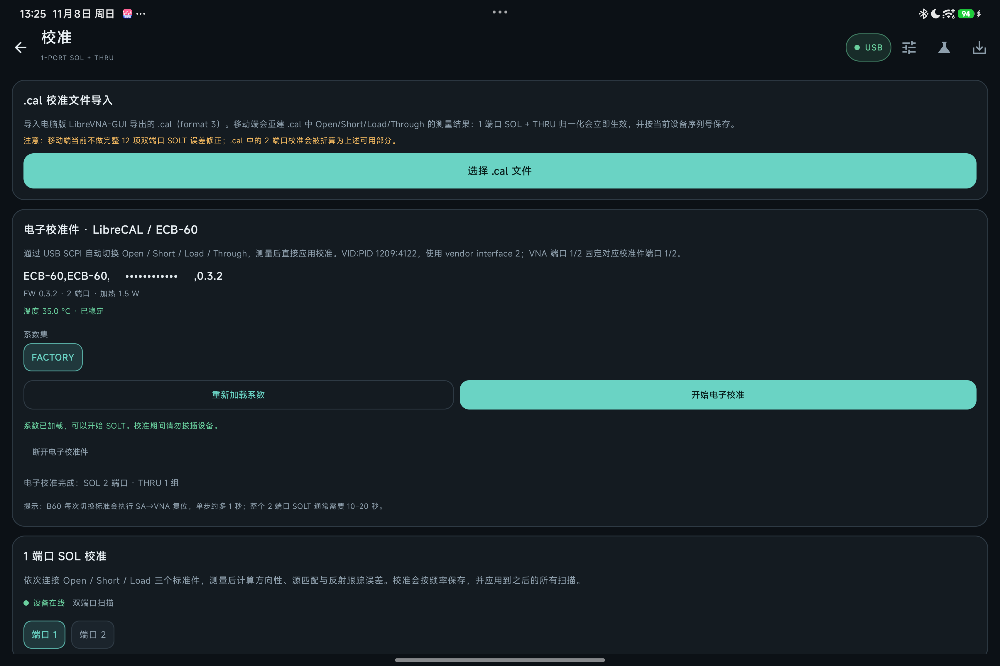

# Calibration guide

> [中文版](../CALIBRATION.md)

DroidVNA supports 1-port SOL, THRU normalization, full 12-term two-port SOLT, LibreCAL / ECB-60 electronic calibration kits, and `.cal` files from the desktop LibreVNA-GUI.

Results are saved immediately as a snapshot and **isolated per device serial**: a demo-mode or other VNA calibration is never applied to the current device. The snapshot is loaded and applied automatically after a restart.

## Calibration methods at a glance

| Method | Standards needed | What it corrects |
| --- | --- | --- |
| 1-port SOL | Open / Short / Load | Directivity, source match, reflection tracking |
| THRU normalization | Through | 0 dB normalization of S21 / S12 (no mismatch correction) |
| Full 12-term SOLT | Open / Short / Load on both ports + THRU, optional isolation | Directivity, source match, reflection tracking, receiver match, transmission tracking, isolation |
| Electronic calibration kit (LibreCAL / ECB-60) | The kit itself | Solved from kit coefficients: 1-port SOL for a 1-port kit, full SOLT for a 2-port kit |
| `.cal` import | A calibration finished in the desktop app | Rebuilt from the file (full SOLT when the data allows) |

## Importing a .cal from the desktop app

1. Finish the calibration (SOL / SOLT / THRU) in the desktop LibreVNA-GUI and save it as a `.cal` (format 3).
2. Copy the `.cal` to the tablet (USB, cloud storage, LocalSend — anything works).
3. Connect the VNA first, then open "Calibration → .cal calibration file import → Choose .cal file".
4. The app parses the calkit and measurement points, rebuilds the calibration (full 12-term SOLT when there is enough data), and saves it under the current VNA serial.

Limitation: if the `.cal` contains only 1-port measurements, the app can only rebuild 1-port SOL + THRU; a full 12-term SOLT requires 1-port measurements for both ports plus THRU. If the file was recorded on another VNA, the UI warns that accuracy may drop. Calkits support Touchstone data as well as purely parametric Open/Short/Load (C/L/Cfirst, etc.) and parametric Through (Z0/delay/loss).

## Electronic calibration kit LibreCAL / ECB-60

1. Connect the VNA and the calibration kit through an OTG hub with external power (the ECB-60 has a heater; phone power alone may not be enough).
2. "Calibration → Electronic calibration kit" → "Detect and connect", allow USB access, and confirm IDN / FW / ports / temperature.
3. Choose a coefficient set (usually `FACTORY`) → "Load coefficients" and wait for 100%.
4. Keep the manual mapping VNA P1 ↔ Cal P1, P2 ↔ Cal P2; **do not use Auto**. Tap "Start electronic calibration".
5. The app first switches **all E-Cal ports that will be used to the same standard** (Open/Short/Load), then measures all VNA ports; before THRU it sets them all back to NONE, establishes the P1→P2 through, and sets all cal ports back to NONE at the end.
6. A two-port kit solves the **full 12-term SOLT** in one go and applies it immediately; a one-port kit only yields 1-port SOL.

**The isolation measurement is an optional checkbox, off by default.** Enabling it spends a few more seconds at the end switching all cal ports to LOAD and measuring isolation once. It is off by default because two-port electronic kits such as the ECB-60 have inherently poor isolation paths: what they measure is often worse than isolation measured with two mechanical 50 Ω loads. In that case it is better to complete the other 11 terms with the E-Cal and then **re-measure isolation separately** with mechanical loads (see the next section).

Note: when the temperature is not stable the app waits up to 90 seconds; on the B60 every standard switch performs an SA→VNA reset, so the whole procedure takes longer than on the desktop. Port state is verified with `:PORT?` every time, and the coefficient stream must be complete; otherwise the app aborts or falls back to point-by-point reading, avoiding truncated coefficients that would produce "spurious" calibrations.

**E-Cal on real hardware (ECB-60, FW 0.3.2; FACTORY coefficients loaded and calibration flow):**

## Manual 1-port SOL

1. Connect the device or start demo mode.
2. Open the Calibration page and choose port 1 or port 2.
3. Connect **Open / Short / Load** in order as prompted (port 2 switches to a two-port sweep automatically).
4. Tapping "Capture" waits for the next complete sweep and stores the raw data.
5. Tap "Compute and apply port N SOL".
6. To correct the S21/S12 response, connect Port 1 directly to Port 2, capture THRU, and tap "Apply THRU normalization".

## Manual full SOLT (two-port)

1. Connect a two-port device (or start demo mode) and fix the sweep frequency and point count first.
2. Capture **port 1** Open / Short / Load, then **port 2** Open / Short / Load (switch "Port 1 / Port 2" on the Calibration page).
3. Connect P1 ↔ P2 with a low-loss through and capture **THRU**. If the through has extra electrical length, enter it in "THRU delay" in picoseconds.
4. Optional: terminate both ports with 50 Ω loads and capture **ISOLATION** to subtract residual crosstalk from S21 / S12; otherwise zero isolation is assumed.
5. Tap "Compute and apply full SOLT".

## Re-measuring / replacing the isolation term separately

The isolation term can be **replaced without redoing the other measurements**, whether the current calibration came from manual SOLT, `.cal` import, or E-Cal:

1. Keep the current sweep settings, and terminate both ports with 50 Ω loads.
2. Tap **Capture** on the ISOLATION card in the "Two-port SOLT" section.
3. Tap **"Update isolation from this capture"**.

Why this works: transmission tracking is derived from `(measured THRU S21 − isolation)`, so changing isolation requires recomputing T. The app stores the THRU measured and ideal values together in the calibration snapshot (`calibration.json` under `solt.through`), so the recomputation is **exact**, not approximate — reflection terms and load match do not change. You can also zero the isolation with "Clear isolation correction".

LibreVNA's `.cal` format itself stores data **per measurement** (one entry per item under `measurements`; isolation is a separate `Isolation` item), so this "replace one measurement" approach matches the desktop data model; the limitation was only in our own `calibration.json`, which now also stores the raw THRU data and can therefore recompute exactly.

## Calibration memory and the calibrated band

- Calibration is saved by frequency to the app's private directory (`filesDir/calibration.json`, format version 3; older files can still be loaded) and is loaded and applied automatically after a restart.
- Snapshots record the device serial, source (manual SOLT / SOL / THRU / E-Cal / `.cal` import), and update time. They are visible under "App settings → Calibration memory" and can be disabled or deleted with one tap.
- The top of the measurement page shows "Loaded the previous calibration"; "disable calibration" keeps the coefficients but shows raw data only, while "forget the saved calibration" deletes the snapshot.
- **A warning appears when the sweep range exceeds the calibrated band**: the "Calibration" card on the measurement page and the status card on the Calibration page show "The sweep range covers an uncalibrated band" and list the calibrated band; out-of-band points are treated as uncalibrated (matching the correction engine, which skips out-of-band points).

## Implementation notes

- 1-port error model: `Γm = e00 + e01e10·Γa / (1 - e11·Γa)`. The Open/Short/Load measurements solve e00, e11, and e01e10 (the same closed form as LibreVNA-GUI's `computeOSL`), then interpolate and apply them to S11 or S22 by frequency.
- 12-term model: on top of the three 1-port terms, the THRU measurement solves receiver match (load match), transmission tracking, and isolation, for 12 terms total; correction is applied point by point with the multiport formula `S = B·A⁻¹` (complex 2×2 solves use Apache Commons Math's `FieldLUDecomposition`).
- When a full SOLT exists it takes precedence over 1-port SOL / THRU normalization; having both does not double-correct.
- Standards are treated as ideal Open (Γ=+1), Short (Γ=-1), Load (Γ=0), and THRU (ideal through) by default; Open/Short offset delay and THRU delay (ps) can be entered.
- **Manual SOLT validates the sweep range of every capture**: Open/Short/Load/THRU/isolation must have identical start and stop frequencies, otherwise the app refuses and reports it (resampling onto a narrower grid silently clamps out-of-band points to the endpoint value, producing wrong error terms with no visible symptom). `.cal` import also requires THRU and port 2 to cover port 1's band, otherwise no full SOLT is generated and a warning is shown.
- **Refuses to solve when standards are too close**: a singular equation (determinant near zero) or a solved directivity/source-match magnitude above 10 (physically impossible) is treated as no solution instead of applying absurd coefficients. Note that this only catches cases that "blow up" numerically; swapping Open and Short cannot be detected from the data itself.
- THRU normalization stores `measured / ideal` (consistent with `.cal` import semantics); with zero THRU delay the ideal through is 1, equivalent to classic 0 dB normalization.
- **Still not implemented**: source/receiver amplitude calibration (power calibration), frequency calibration, and high-order calibration-kit coefficient fitting; standards are treated as ideal or as imported Touchstone / parametric models. Use the desktop LibreVNA-GUI when metrology-grade results are required.

## Known limitations

- Full 12-term SOLT supports two ports (two ports already covers all 12 terms); three/four-port extensions are not implemented. Manual THRU is treated as an ideal through; for a non-ideal through, enter its delay or use E-Cal / `.cal`.
- Two-port electronic kits (such as the ECB-60) have poor isolation paths, so the E-Cal's built-in isolation measurement is off by default; when isolation correction is needed, measure it separately with two mechanical 50 Ω loads (the Calibration page can replace just the isolation term).
- There is no standalone Touchstone calibration-kit file import; `.cal` import can rebuild a full SOLT, but a 1-port `.cal` still yields only 1-port SOL + THRU.
- E-Cal uses a fixed VNA P1/P2 ↔ Cal P1/P2 mapping with no automatic port detection; an externally powered OTG hub is required.
- For "the trace does not change after calibration" and `.cal` import failures, see [Troubleshooting](TROUBLESHOOTING.md).

See [Roadmap and limitations](ROADMAP.md) for more.
