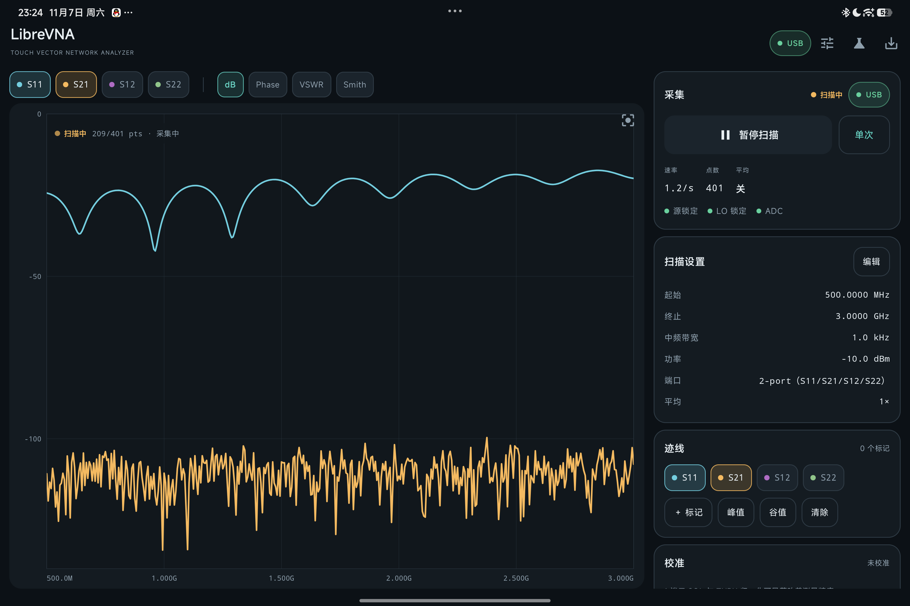
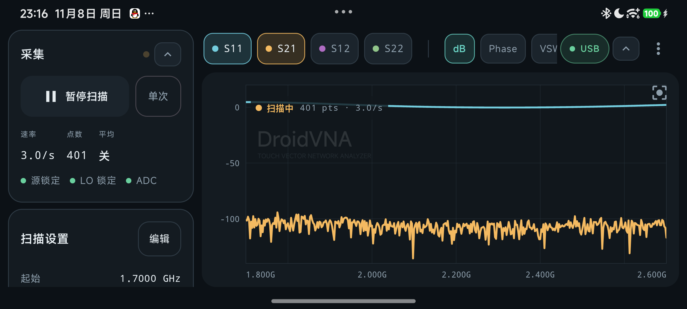
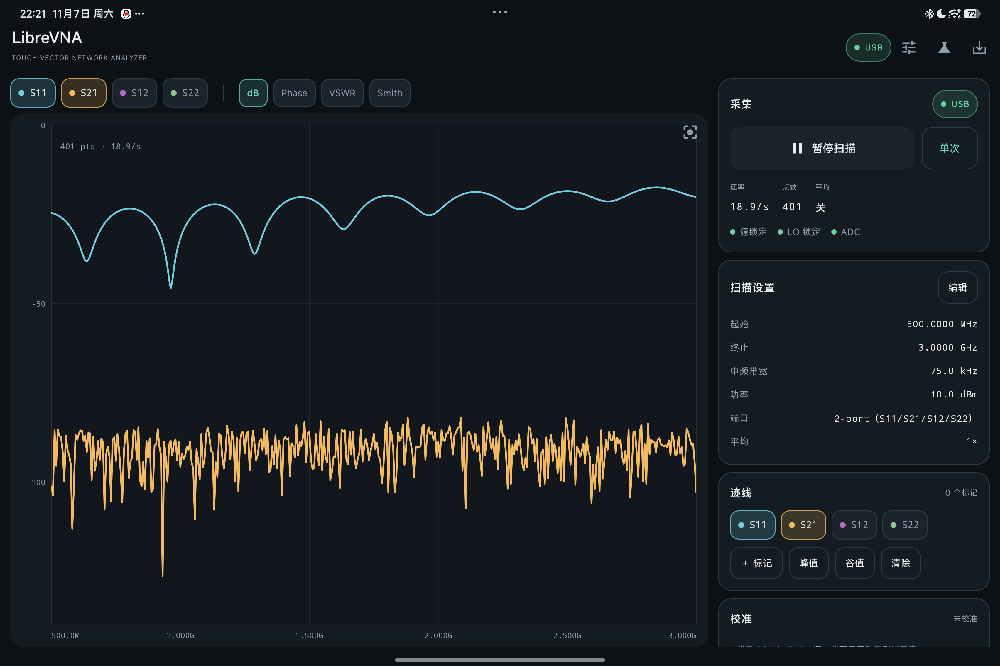
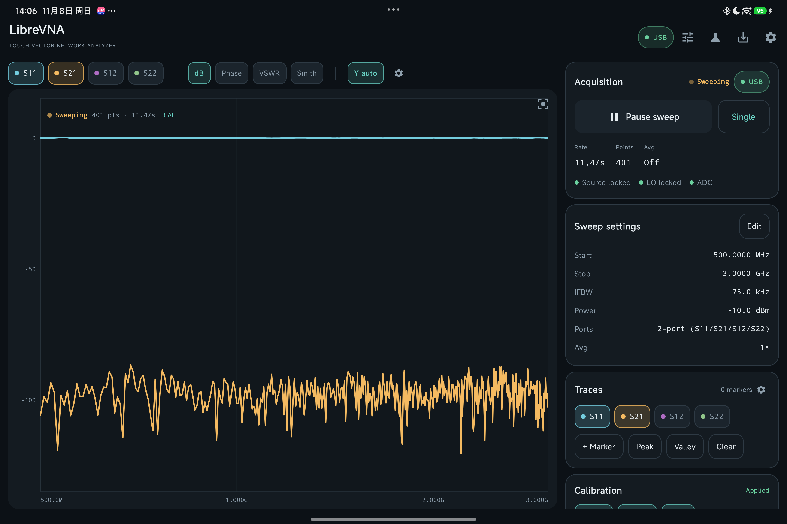
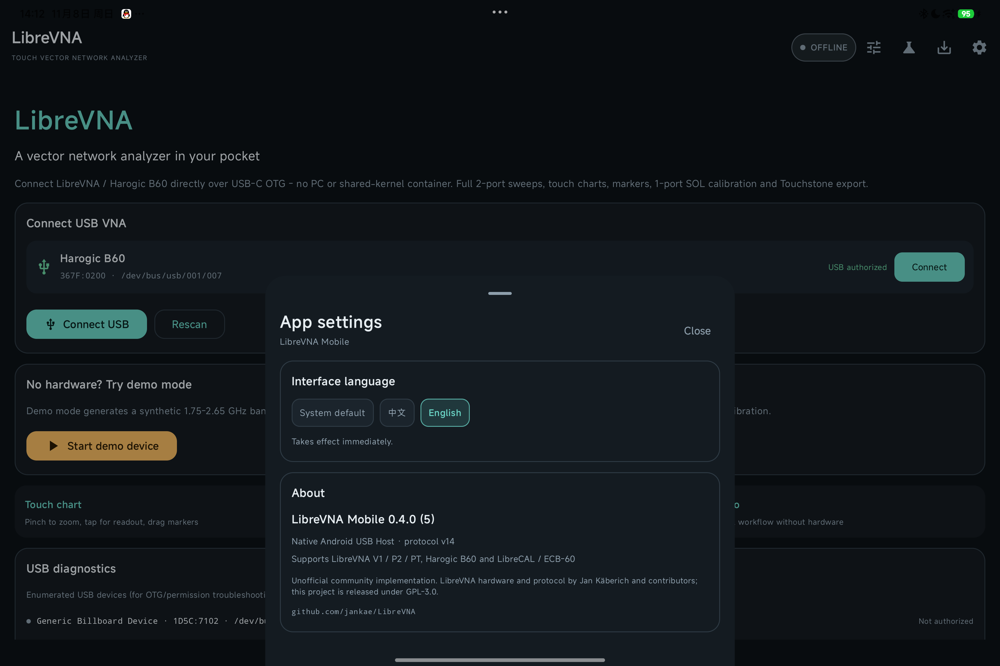
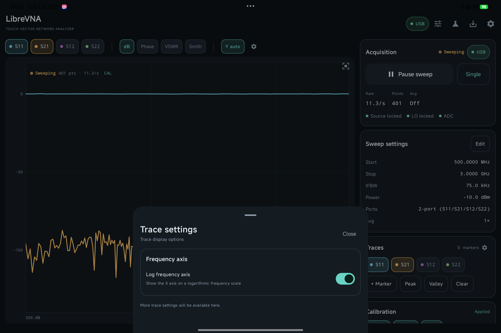

# User guide

> [中文版](../USER-GUIDE.md)

This guide covers installing DroidVNA, connecting a device, touch gestures, UI settings, and data export.

- Calibration (SOL / SOLT / E-Cal / `.cal` import): see the [Calibration guide](CALIBRATION.md)
- Problems: see [Troubleshooting](TROUBLESHOOTING.md)
- Building and development: see [Building and development](DEVELOPMENT.md)
- Version history: see [CHANGELOG](../../CHANGELOG.md) and [release notes](release-notes/)

## Feature overview

### Measurement and charts

- **Real-time two-port sweeps**: S11 / S21 / S12 / S22, continuous or single sweeps, pause/resume.
- **Visible progress on slow sweeps**: at low IFBW, when the first frame is slow, both the "Acquisition" card and the chart show a breathing indicator that a sweep is running; points that have arrived are drawn immediately instead of waiting for the whole frame.
- **Ring-buffer updates**: continuous sweeps no longer clear and redraw the chart every frame. New-frame points overwrite previous ones one by one, and points that have not arrived keep the previous value, so the chart always shows a complete trace and reading is never interrupted.

  

- **Y-axis auto / manual**: the `Y auto` button above the chart switches between auto and manual scaling; pinching the chart switches to manual, and one tap restores auto.
- **Touch-first chart**:
  - Pinch to zoom / pan (both axes); the Smith chart has its own zoom/pan viewport
  - Tap or drag with one finger for cursor readout
  - Drag a marker line to change its frequency; tap `FIT` to restore the full span
  - dB, phase, VSWR, and Smith chart display modes
  - Trace settings can enable a **log frequency axis**, with 1-2-5 logarithmic ticks on X
- **Markers**: add, drag, and delete freely; peak/valley search; dual-marker Δ difference.
- **Analysis**: the "Analysis ▾" menu next to the marker row provides three tools.
  - **Bandwidth search**: use the peak or a custom cursor (an existing marker) on the selected S-parameter trace as the reference, find both edges at -X dB (default -3 dB), and add the two edge markers.
  - **XdB search**: the general form of bandwidth search, with a choice of left, right, or both sides; bandwidth search is the both-sides XdB search.
  - **DTF (time domain / distance to fault)**: windowed IFFT of the S11 / S22 complex reflection, converted to fault distance using the velocity factor; configure the window, velocity factor, IFFT zero-padding, peak threshold, and cable-loss compensation, and get a distance-domain trace plus a fault table.

### UI and interaction

- **Single top-right menu**: all settings entry points (sweep settings, trace settings, calibration, export, device, app settings, hide controls) live in the top-right `⋮` menu; the measurement page has no title bar, so the trace chart uses the full height.
- **Background watermark**: the DroidVNA mark is drawn as a translucent watermark behind the trace chart (beneath the traces). "Disable app watermark" in App settings removes the whole layer.
- **Collapsible control rows**: the trace/mode/Y-axis row and the acquisition card column on the right of large screens can be collapsed with one tap (menu "Hide trace controls", the `⌃` button at the end of the row, or `⌃` on the acquisition card). The chart gets larger while marker shortcuts remain.
- **Vertical acquisition rail in landscape**: on a phone in landscape, acquisition controls no longer squeeze into the bottom; they form a column pinned to the left, with the chart on the right.

  

- **Remembered settings**: sweep parameters, marker positions, trace parameters, chart mode, Y-axis scaling, log frequency axis, watermark switch, collapsed-control state, and UI language are saved automatically and restored on the next launch; "Auto-start sweep after connect" can be turned off to require tapping "Start sweep".
- **Chinese/English UI**: `⋮` → "App settings" → "Interface language" offers Follow system / Chinese / English; switching takes effect immediately and persists. About information is in the same panel.

### Calibration and data

- **Calibration memory**: SOLT / SOL / THRU / E-Cal / `.cal` import results are saved immediately as a snapshot tagged with the device serial and source, loaded automatically on the next launch, and shown as "Loaded the previous calibration" at the top of the measurement page. You can "disable calibration" (keep the coefficients) or "forget the saved calibration" at any time. See the [Calibration guide](CALIBRATION.md).
- **1-port SOL calibration**: Open / Short / Load, solving directivity, source match, and reflection tracking, saved by frequency and applied with interpolation; optional manual delay. Calibrations are isolated per device serial, so a demo/other device's calibration is never applied to a B60.
- **Full 12-term two-port SOLT**: Open / Short / Load on both ports + THRU, optionally one isolation measurement, solving directivity, source match, reflection tracking, receiver match, transmission tracking, and isolation, then correcting every point with the multiport formula `S = B·A⁻¹`. Unlike THRU normalization it also removes port mismatch, so S21 / S12 stay accurate with strong port reflections.
- **THRU normalization**: through-response calibration for S21 / S12 (0 dB normalization only, no mismatch correction; still useful for single-port devices or old calibrations).
- **Desktop `.cal` import**: reads a LibreVNA-GUI format-3 `.cal`, rebuilds the calibration on the phone, and applies it immediately; when both ports' 1-port measurements and THRU are present it rebuilds the full 12-term SOLT (including Isolation), otherwise it falls back to 1-port SOL + THRU; saved under the current VNA serial.
- **Electronic calibration kits (LibreCAL / ECB-60)**: reads FACTORY coefficients over USB SCPI and switches Open/Short/Load/Through automatically; a two-port kit solves the full 12-term SOLT directly. **The isolation measurement is an optional checkbox (off by default)** because two-port E-Cals such as the ECB-60 have poor isolation paths; you can measure isolation later with mechanical 50 Ω loads. Temperature/stability status is shown.
- **Export**: Touchstone `.s2p` / `.s1p` and CSV to `Download/DroidVNA`, or send through the system share sheet. See [Export](#export).
- **Demo mode**: a built-in 1.75–2.65 GHz band-pass filter DUT and a realistic systematic error model, so the complete SOL calibration and export flow works without hardware.

### Device and connection

- **Device page**: hardware/firmware/protocol versions, lock and temperature status, USB diagnostics, device log.
- **Protocol v14**: supports LibreVNA V1 / P2 / PT and Harogic B60 (the same USB protocol; the device's DeviceInfo is authoritative).
- **Plug and play**: recognizes LibreVNA `0483:564E`, `0483:4121`, `1209:4121` and Harogic B60 `367F:0200`, with a consistent USB attach intent and permission flow; the E-Cal is recognized as `1209:4122` (LibreCAL / ECB-60).

## Installation

Prebuilt release APK (in the repository): [dist/DroidVNA-0.7.1-beta-release.apk](../../dist/DroidVNA-0.7.1-beta-release.apk)

```
dist/DroidVNA-0.7.1-beta-release.apk
size: 13,225,872 bytes
SHA-256: F8C80D0FC10E093E94503C29A5E71A44F6B671E28E61C56E89A37DDBFD190500
version: 0.7.1-beta (versionCode 10)
```

```bash
adb install -r dist/DroidVNA-0.7.1-beta-release.apk
```

You can also download the same version from the repository's **Releases** page. The APK is a release build signed with the project release key (certificate CN=Houran CHEN); re-signing with a different keystore prevents in-place upgrades, so uninstall first. See [Releasing](RELEASING.md) for the signing flow.

If Xiaomi/Redmi/HyperOS reports `INSTALL_FAILED_USER_RESTRICTED: Install canceled by user`, use the shell installation method or enable **Install via USB** in Developer options; see [Troubleshooting](TROUBLESHOOTING.md) for the exact commands.

Requirements:

- Android 8.0 (API 26) or newer
- A tablet or phone with USB Host / OTG support
- A USB-C cable / OTG adapter that supports data transfer
- LibreVNA / Harogic B60 firmware protocol version 14 (upgrade older firmware with the desktop LibreVNA-GUI first)

## Connecting a USB VNA

1. Connect the LibreVNA or Harogic B60 to the tablet/phone with an OTG adapter and power the device.
   - Harogic B60 / VNB-60 appears as **B60** in the system with VID:PID `367F:0200`.
2. Open the app; when the top status says **OFFLINE**, tap it to open the Device page.
3. Tap **Connect** under "USB devices".
4. Allow access in the system USB permission dialog.
5. When connected, the status becomes **USB** and the Device page shows hardware, firmware, temperature, lock status, and the live sweep rate.

> The LibreVNA / B60 USB power budget is about 500 mA. Some phones limit current; a USB-C hub with external power is recommended. The Device page's "USB diagnostics" lists every USB device enumerated by the system and its authorization state, which helps diagnose OTG/cable issues.

**Harogic B60 on real hardware (401 points / 75 kHz IFBW, port open):**



### Harogic B60 firmware 1.8.6 first-configuration issue and automatic recovery

The B60 (VNB-60, FW 1.8.6, HW 0xD0) has a known firmware behavior: the **first VNA SweepSettings after connecting is ACKed** but the sweep does not actually start; after 2 seconds the firmware times out and re-initializes, which shows up as a status every 2 seconds in the log and 0 datapoints. The desktop LibreVNA-GUI works around it by switching to SA mode and back to VNA, or by reconnecting.

This app automatically performs an SA → VNA mode reset **before every sweep configuration sent to a B60** (sends a valid SA configuration frame, then SetIdle, then the VNA configuration), including on connect, after changing IFBW/points/frequency, and when resuming a sweep. Users therefore never need to switch to SA manually, and switching from low IFBW back to high IFBW does not leave the device slow. If the reset still fails, a background watchdog performs another SA reset after 8 seconds without data; if that also fails, the app suggests replugging the device in Device → Log. The timeout is 8 seconds rather than scaling with IFBW, to avoid mistaking a genuinely slow low-bandwidth sweep for a hang (the first datapoint of a normal sweep still arrives within milliseconds).

- The B60 defaults to **75 kHz IFBW** (spec range **15 Hz – 75 kHz**) and **401 points**; a 75 kHz continuous sweep measures about **19–20 sweeps/s**. The B60 DeviceInfo misreports 11 Hz – 93.5 kHz; the app overrides it with the specification range 15 Hz – 75 kHz.
- This workaround only changes the device's current SA/VNA mode; it does not modify the B60's persistent DeviceConfiguration or calibration data.
- If Harogic releases fixed firmware later, the reset logic can be removed.
- Low IFBW (such as 1 kHz, 100 Hz, 15 Hz) significantly increases per-point integration time: both the first frame and the whole frame are slower, but the app draws as it sweeps and shows a breathing indicator next to "Acquisition", so it never looks hung.

## Touch gestures

- **One finger**: tap or drag on the chart for cursor readout; drag near a marker line to move the marker.
- **Two fingers**: pinch to zoom; drag with two fingers to pan.
- **FIT** (top-right of the chart): restore the full span / auto Y-axis.
- **Double-tap**: also resets the view.
- **Markers**: "+ Marker" in the side panel adds a marker at the center of the span; "Peak"/"Valley" search automatically; the × on a marker card deletes it.
- **Analysis**: "Analysis ▾" in the marker row opens bandwidth search / XdB search / DTF; a new analysis replaces the markers created by the previous analysis and leaves manual markers untouched.
- **Pause**: the large button at the top/side pauses or resumes continuous sweeping; "Single" triggers one standby sweep.
- **Y axis**: `Y auto` / `Y manual` in the control row toggles auto and manual scaling; after manual pinch-zoom, one tap restores auto.
- **Traces**: trace-parameter chips in the control row toggle S11/S21/S12/S22; the mode chip switches dB/Phase/VSWR/Smith.
- **Hide controls**: the `⌃` at the end of the control row hides the whole row, equivalent to "Hide trace controls" in the menu; `⌃` on the acquisition card on large screens hides that column.

## UI and settings

### Top-right menu

The measurement page has a single control row: trace/mode/Y-axis selectors on the left (horizontally scrollable), connection status, the collapse button, and the single `⋮` menu on the right. Menu items:

- **Sweep settings**: start/stop frequency, points, IFBW, power, averaging, single/two-port, log sweep, auto continuous sweep.
- **Trace settings**: log frequency axis, Y-axis autoscale switch, current trace summary.
- **Calibration** / **Export** / **Device**: open the calibration wizard, export panel, or Device page.
- **Hide / show trace controls**: equivalent to the `⌃` at the end of the control row.
- **App settings**: see below.

### App settings

- **Interface language**: Follow system / Chinese / English; applied immediately and persisted.
- **Interface → Disable app watermark**: when enabled, the translucent DroidVNA mark is no longer drawn behind the trace chart.
- **Remembered settings → Remember sweep settings**: reuse the frequency range, points, IFBW, power, and averaging on the next launch.
- **Remembered settings → Auto-start sweep after connect**: when off, connecting only sends the settings; tap "Start sweep" manually.
- **Calibration memory → Auto-save and load the last calibration**: shows the saved calibration's source (E-Cal / `.cal` import / manual SOL), ports, THRU count, save time, and device serial; you can "disable calibration" (keep coefficients, show raw data only) or "forget the saved calibration".
- **About**: version, protocol, supported devices, GPL-3.0, and upstream project information.

Settings live in the app's private directory: `filesDir/settings.json` (written via a temporary file plus rename, so a power loss never leaves a half-written file).

**English UI / App settings:**

| English UI | App settings |
| --- | --- |
|  |  |

### Trace settings

Open it from the end of the chart control row, the gear on the right of the "Trace" card, or the top-right menu. It currently contains:

- **Log frequency axis**: display X on a logarithmic frequency axis with 1-2-5 log ticks; turn it off to return to a linear axis.
- **Y-axis autoscale**: when off, the current Y range is locked, equivalent to double-tapping the chart to restore auto.

Future trace display options will continue to be added to this panel.



## Export

Open "Export measurement data" from the measurement page or the top save button:

- Touchstone `.s2p`: `# Hz S RI R 50`, columns S11 S21 S12 S22 (re/im per column).
- Touchstone `.s1p`: S11 only.
- CSV: frequency plus dB / phase for each parameter.
- Location: `Download/DroidVNA` (Android 10+, MediaStore); Android 8/9 saves to the app's external directory.
- Share button: send the file through the system share sheet.

File names look like `droidvna_20261107_205533_cal.s2p`. `cal` means the current data has calibration applied; `raw` means uncalibrated.

## Demo mode

Without hardware, use the built-in demo mode: the DUT is a 1.75–2.65 GHz band-pass filter with a realistic systematic error model, so you can walk through sweeping, SOL calibration, markers, and export end-to-end — useful for getting familiar with the UI on a tablet first.

## Known limitations

See [Roadmap and limitations](ROADMAP.md) for the complete list.

## Troubleshooting

Common connection, installation, calibration, and E-Cal issues are covered in [Troubleshooting](TROUBLESHOOTING.md).
